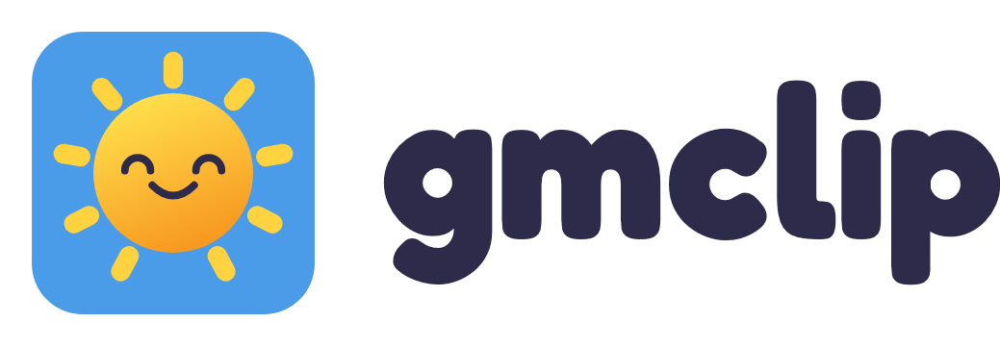
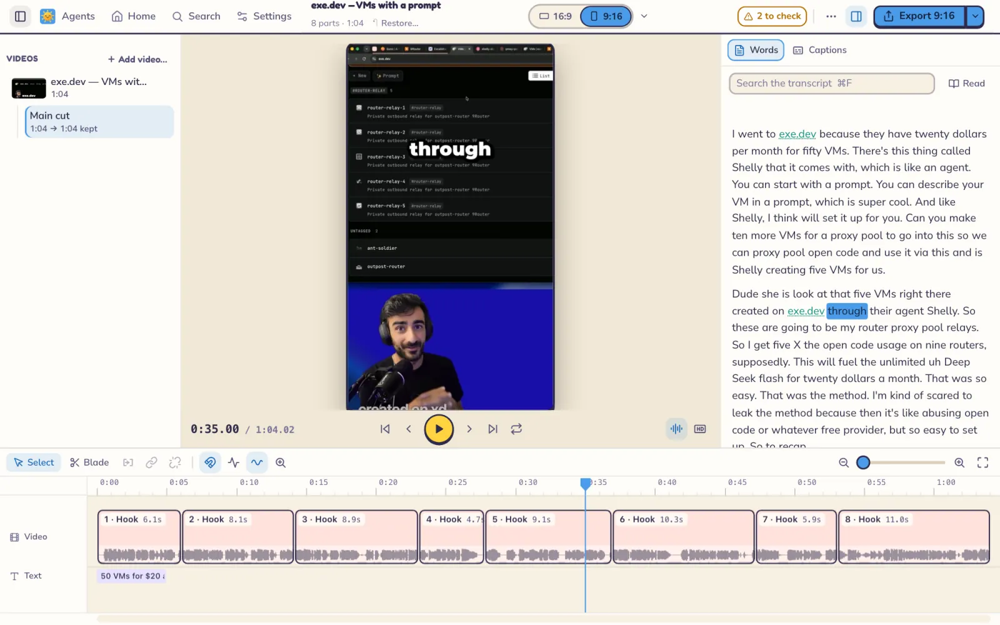
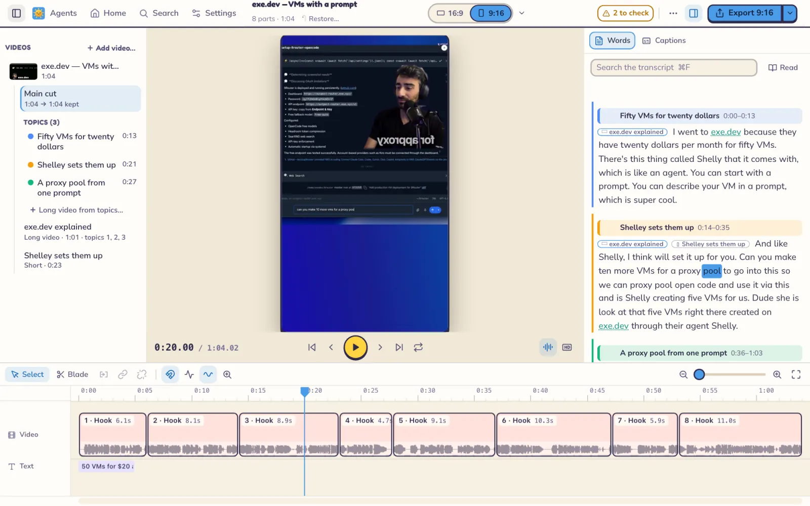
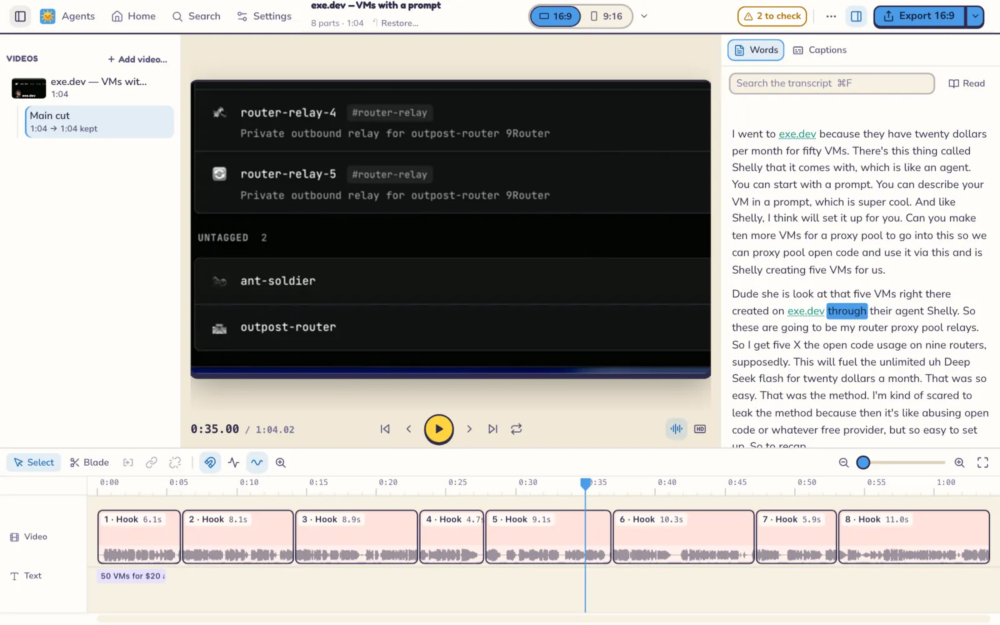
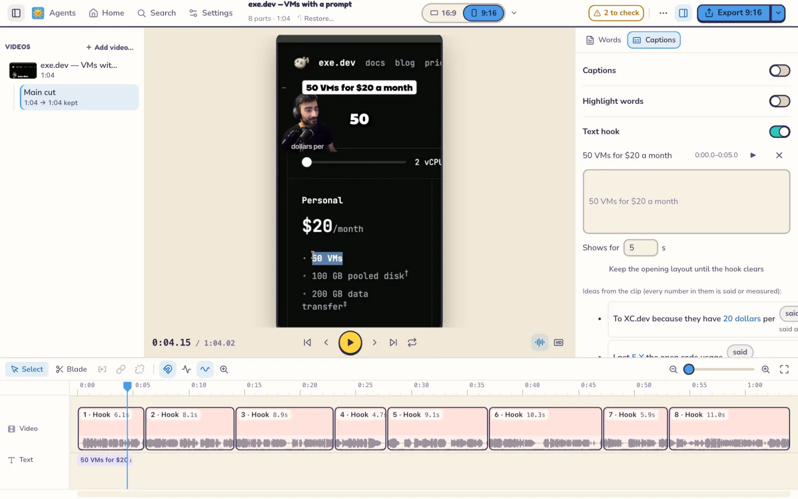
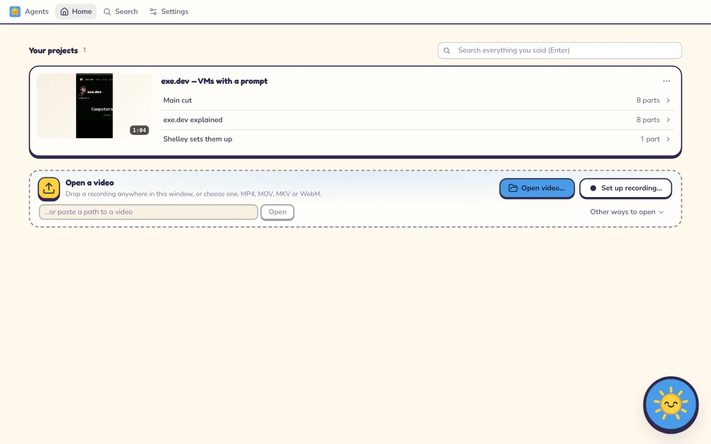
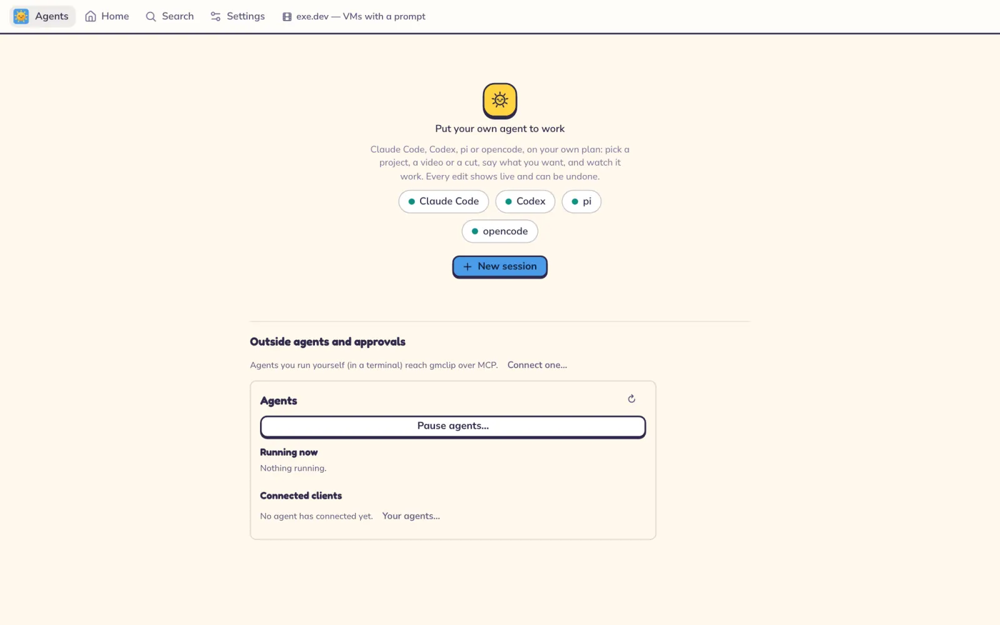

<p align="center">
  <picture>
    <source media="(prefers-color-scheme: dark)" srcset="assets/brand/logo-lockup-light.png">
    
  </picture>
</p>

<p align="center"><a href="https://gmclip.com">gmclip.com</a> · <a href="https://github.com/aj47/gmclip-video/releases/tag/v0.1.0">Download v0.1.0</a></p>

<picture>
  <source media="(prefers-color-scheme: dark)" srcset="docs/screenshots/editor-vertical-dark.webp">
  
</picture>

A desktop video editor for turning long recordings into vertical and horizontal cuts. You
edit a cut by editing its words. Every feature is one command, and the UI, the CLI and a
built-in MCP server all call the same command list, so an agent such as Claude Code or
Codex can do anything you can except change owner settings. Rust core, Tauri shell,
SolidJS UI. Decode and encode go through the operating system's codecs; there is no
ffmpeg.

**Status: v0.1.0, an early release.** gmclip runs on macOS 14 or later on Apple silicon,
and the Windows x64 build works too. The Intel Mac build is new and less tested. The
installers are not signed yet. Formats and commands still change.

## Download

| Your computer | Installer |
|---|---|
| Mac with an Apple chip (M1 or later) | [gmclip-0.1.0-macos-arm64.dmg](https://github.com/aj47/gmclip-video/releases/download/v0.1.0/gmclip-0.1.0-macos-arm64.dmg) |
| Mac with an Intel chip | [gmclip-0.1.0-macos-x64.dmg](https://github.com/aj47/gmclip-video/releases/download/v0.1.0/gmclip-0.1.0-macos-x64.dmg) |
| Windows 10 (1809) or 11, x64 | [gmclip-0.1.0-windows-x64.msi](https://github.com/aj47/gmclip-video/releases/download/v0.1.0/gmclip-0.1.0-windows-x64.msi) |

Each installer has a `.sha256` file beside it on the
[release page](https://github.com/aj47/gmclip-video/releases/tag/v0.1.0).

The installers are unsigned, so your system warns you the first time:

- **macOS:** open the disk image and drag gmclip to Applications. When macOS says it
  cannot check gmclip, open System Settings → Privacy & Security and click **Open
  Anyway**, or run `xattr -dr com.apple.quarantine /Applications/gmclip.app` once.
- **Windows:** when SmartScreen says "Windows protected your PC", click **More info**,
  then **Run anyway**. gmclip needs the WebView2 runtime, which Windows 11 ships.

There is no Linux installer yet; on Linux you can build and test the core crates.

## Features

Everything here is in v0.1.0, on macOS and Windows unless it says Mac only.

**Word-based editing**
- Cut and restore by editing the transcript; the Words panel reads as prose
- Word-snapped trims
- Tighten pauses and fillers
- Find and replace, and fix a misheard word everywhere
- Versions and history

**Framing**
- 9:16 and 16:9 from one edit, with crop versions
- Full screen, or screen and facecam
- Follow-the-action crop
- Blurred fill and gradient plates
- Cut-outs without a green screen (built on a Mac; Windows plays them)
- Pin an overlay to motion (Mac only)

**Captions and text**
- Burned-in captions timed to each cut's own audio, with keyword highlights
- Text hooks, section labels and a stopwatch
- Stressed-word emphasis and punch-ins
- A caption style gallery
- New shorts are titled from their hook or topic

**Timeline**
- Several videos in one project
- Non-destructive trims that only hide
- Stream edits, topics and long-form cuts
- YouTube chapters
- Voice and hi-res picture pairing
- Recording your screen, camera and mic into a project (Mac only)

**Audio**
- An audio lane with waveforms
- Volume per part and per span, with fades
- −16 LUFS loudness on export

**Export**
- Reels and YouTube presets at 1080p, 1440p and 4K
- Thumbnails with versions
- Copy drafts per platform
- Alternate openings to test
- Moment clips (Mac only)

**Agents and MCP**
- A built-in MCP server gives an agent every feature
- Claude Code, Codex, pi and opencode, each run limited to gmclip's tools
- Your agent finds moments and grows a story; nothing runs until you click
- Overnight batches with budget limits
- "Fix with my agent" from a comment

**Review from your phone**
- Scan a QR code and give notes from your phone
- Keep, change or drop each cut
- Comments pinned to the moment, and suggested edits you approve
- A retention CSV on the timeline

**Brand kit**
- Name, handle, colours, logo and face
- Overlay templates and lower thirds
- End cards that loop to the opening
- A caption style for new projects

**Search and library**
- Search by words or by meaning, across every transcript you own
- Golden cuts and "new cut like this"
- Consolidate a project into one folder

## Screenshots

<table>
<tr>
<td width="50%"><picture><source media="(prefers-color-scheme: dark)" srcset="docs/screenshots/editor-topics-dark.webp"></picture><br>Topics in the project map, a long video and a short made from them</td>
<td width="50%"><picture><source media="(prefers-color-scheme: dark)" srcset="docs/screenshots/editor-horizontal-dark.webp"></picture><br>The same cut at 16:9</td>
</tr>
<tr>
<td><picture><source media="(prefers-color-scheme: dark)" srcset="docs/screenshots/captions-dark.webp"></picture><br>Captions, a text hook and hook ideas from the clip</td>
<td><picture><source media="(prefers-color-scheme: dark)" srcset="docs/screenshots/home-dark.webp"></picture><br>Home and your projects</td>
</tr>
<tr>
<td><picture><source media="(prefers-color-scheme: dark)" srcset="docs/screenshots/agents-dark.webp"></picture><br>Put your own agent to work</td>
<td></td>
</tr>
</table>

## Build and run

You need macOS, [rustup](https://rustup.rs) (the toolchain is pinned in
`rust-toolchain.toml`), Node and pnpm.

```bash
cd app/ui && pnpm install --frozen-lockfile && pnpm exec vite build
cd ../src-tauri && cargo build --features custom-protocol
target/debug/gmclip-app
```

If Homebrew's cargo is on your `PATH` ahead of rustup's, it ignores the pinned toolchain:
put `~/.cargo/bin` first.

Speech-to-text uses Parakeet TDT and Silero VAD, which run locally. The app downloads
them on first use; `tools/fetch_models.sh` (`tools\fetch_models.ps1` on Windows) fills the
same cache for development.

The command-line tool builds from the root workspace:

```bash
cargo build -p gmclip-cli        # target/debug/gmclip
```

### Windows

The Windows code builds and runs on Windows 11 x64 with rustup, Node, pnpm, the Visual
Studio Build Tools (the "Desktop development with C++" workload) and the WebView2 runtime,
which Windows 11 ships. In PowerShell:

```powershell
cd app\ui; pnpm install --frozen-lockfile; pnpm exec vite build
cd ..\src-tauri; cargo build --release --features custom-protocol
target\release\gmclip-app.exe
```

`gmclip-app.exe` is a console program (it is the MCP server and `call` too). Run from a
terminal it uses that terminal and prints its errors there; started from Explorer or a
shortcut it would open a console window of its own beside the app. `gmclip-launch.exe`,
built next to it, starts it without that window, and is what the Start menu shortcut of
the installer (`app\scripts\bundle-win.ps1`) runs.

If the build stops with "The paging file is too small for this operation to complete"
(os error 1455), the machine ran out of memory for that many compilers at once: add
`-j 8` to `cargo build`.

## Agents

`gmclip-app mcp` is the MCP server and `gmclip-app call` runs one command. An agent
discovers commands with `commands_search` and `command_describe`, edits through
transactions that can be undone, and looks at rendered frames with `see`. Owner actions
(keys, budgets, file access, letting an agent see footage) need a click from the person
at the machine; see `spec/threat-model.md` and `spec/security-requirements.md`.
`AGENTS.md` is the guidance for an agent editing a project.

## Layout

| Path | What is there |
|---|---|
| `crates/` | The workspace: model, store, core (commands, undo, lint), media (demux, OS codecs, MP4 writer), render (compositor, text, export), analysis, ml, ai, mcp, platform, cli |
| `app/` | The Mac app: `src-tauri/` (Tauri shell, its own Cargo workspace) and `ui/` (SolidJS) |
| `spec/` | The spec, the RenderPlan format, the threat model and security requirements |
| `decisions/` | One note per change made to the spec since it was frozen |
| `schemas/` | JSON schemas and examples for the file formats |
| `xtask/` | Repo checks, run as `cargo xt <name>` |
| `evals/`, `fuzz/`, `tools/` | Agent evals, fuzz targets and their seeds, development scripts |

The spec and code comments cite planning, research and review documents (`STATUS.md`,
`plan/`, `research/`, `critique/`) that are not part of this repository.

## Tests

```bash
cargo nextest run --workspace --locked
cd app/src-tauri && cargo test --features custom-protocol,dev-bridge
```

Tests named `lab` measure against private footage. They read it from the folder
`GMCLIP_LAB_MEDIA` names and skip when a file is not there.

## Licence

Licensed under either of the [Apache License, Version 2.0](LICENSE-APACHE) or the
[MIT license](LICENSE-MIT), at your option. Bundled fonts are under the SIL Open Font
License (`assets/fonts/*/OFL.txt`) and the UI icons are from Lucide
(`app/ui/src/design/LICENSE-lucide.txt`).

Unless you state otherwise, any contribution you submit for inclusion in gmclip, as
defined in the Apache-2.0 licence, is dual licensed as above, without additional terms.
