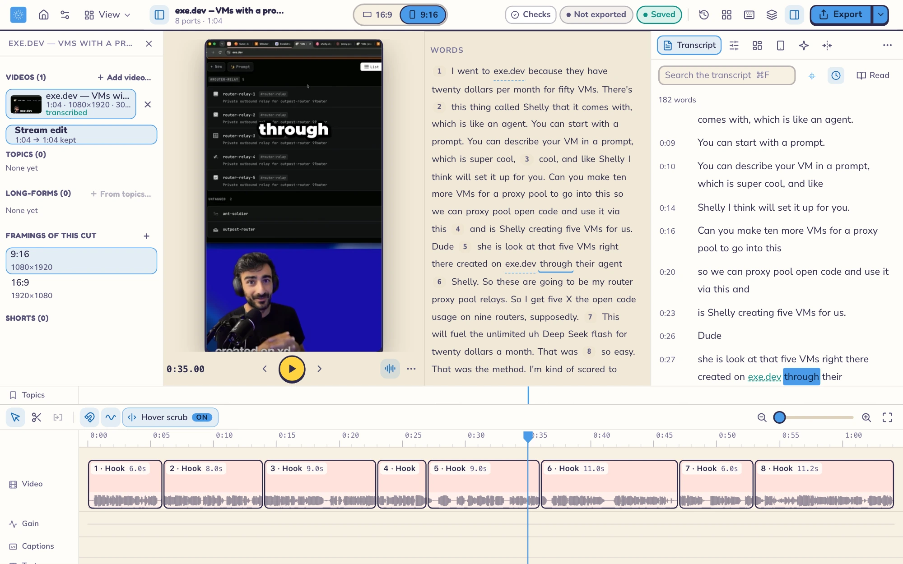
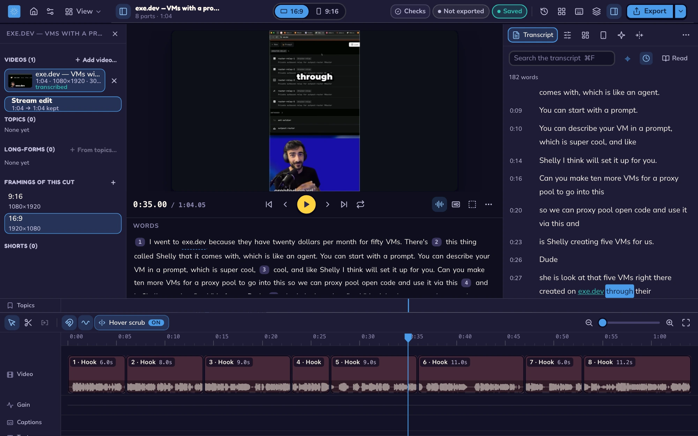
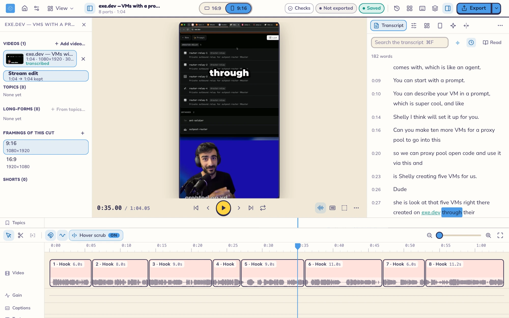
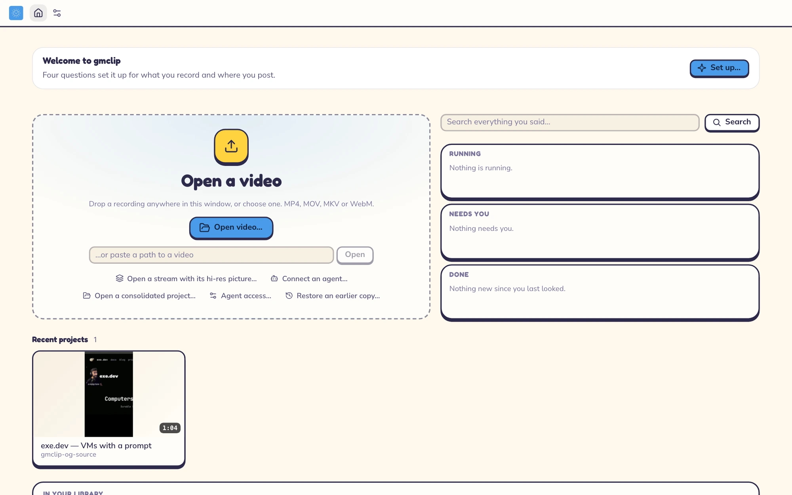
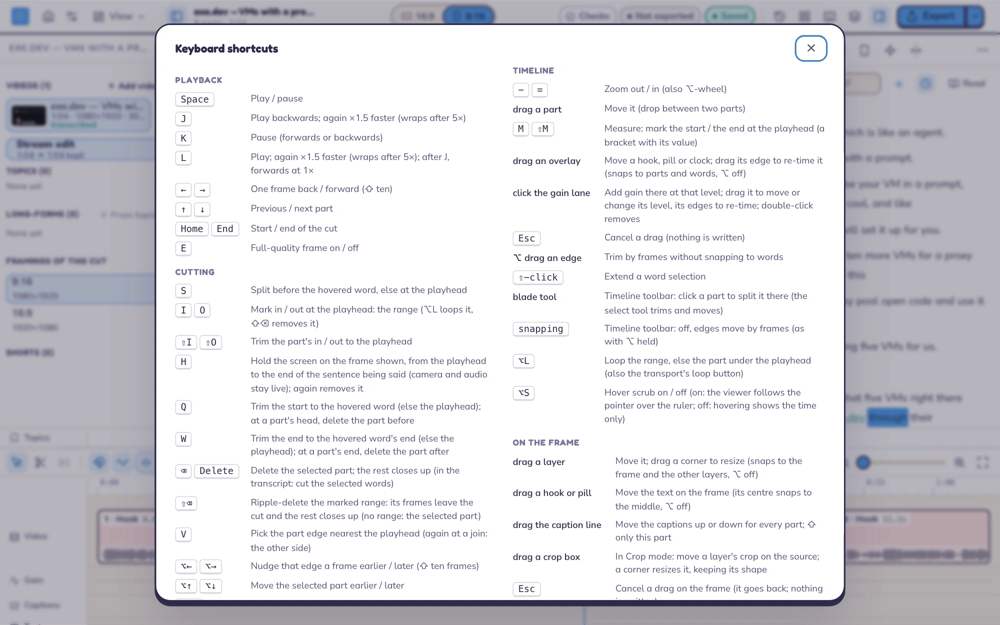

<p align="center">
  <picture>
    <source media="(prefers-color-scheme: dark)" srcset="docs/images/logo-light.png">
    
  </picture>
</p>

<p align="center"><a href="https://gmclip.com">gmclip.com</a></p>



A desktop video editor for turning long recordings into vertical and horizontal cuts. You
edit a cut by editing its words. Every feature is one command, and the UI, the CLI and a
built-in MCP server all call the same command list, so an agent such as Claude Code or
Codex can do anything you can except change owner settings. Rust core, Tauri shell,
SolidJS UI. Decode and encode go through the operating system's codecs; there is no
ffmpeg.

**Status: pre-release.** gmclip runs on macOS 13 or later on Apple silicon. Windows code
exists and is not yet supported. There are no signed builds; you build it from source.
Formats and commands still change.

## Screenshots

| | |
|---|---|
|  |  |
| The same cut framed for 16:9 | Transcript and timeline, part by part |
|  |  |
| Home and the project library | Every key on one sheet |

## Build and run

You need macOS, [rustup](https://rustup.rs) (the toolchain is pinned in
`rust-toolchain.toml`), Node and pnpm.

```bash
cd app/ui && pnpm install --frozen-lockfile && pnpm exec vite build
cd ../src-tauri && cargo build --features custom-protocol
target/debug/gmclip-app
```

If Homebrew's cargo is on your `PATH` ahead of rustup's, it ignores the pinned toolchain:
put `~/.cargo/bin` first.

Speech-to-text uses Parakeet TDT and Silero VAD, which run locally. The app downloads
them on first use; `tools/fetch_models.sh` (`tools\fetch_models.ps1` on Windows) fills the
same cache for development.

The command-line tool builds from the root workspace:

```bash
cargo build -p gmclip-cli        # target/debug/gmclip
```

### Windows (not yet supported)

The Windows code builds and runs on Windows 11 x64 with rustup, Node, pnpm, the Visual
Studio Build Tools (the "Desktop development with C++" workload) and the WebView2 runtime,
which Windows 11 ships. In PowerShell:

```powershell
cd app\ui; pnpm install --frozen-lockfile; pnpm exec vite build
cd ..\src-tauri; cargo build --release --features custom-protocol
target\release\gmclip-app.exe
```

`gmclip-app.exe` is a console program (it is the MCP server and `call` too). Run from a
terminal it uses that terminal and prints its errors there; started from Explorer or a
shortcut it would open a console window of its own beside the app. `gmclip-launch.exe`,
built next to it, starts it without that window, and is what the Start menu shortcut of
the installer (`app\scripts\bundle-win.ps1`) runs.

If the build stops with "The paging file is too small for this operation to complete"
(os error 1455), the machine ran out of memory for that many compilers at once: add
`-j 8` to `cargo build`.

## Agents

`gmclip-app mcp` is the MCP server and `gmclip-app call` runs one command. An agent
discovers commands with `commands_search` and `command_describe`, edits through
transactions that can be undone, and looks at rendered frames with `see`. Owner actions
(keys, budgets, file access, letting an agent see footage) need a click from the person
at the machine; see `spec/threat-model.md` and `spec/security-requirements.md`.
`AGENTS.md` is the guidance for an agent editing a project.

## Layout

| Path | What is there |
|---|---|
| `crates/` | The workspace: model, store, core (commands, undo, lint), media (demux, OS codecs, MP4 writer), render (compositor, text, export), analysis, ml, ai, mcp, platform, cli |
| `app/` | The Mac app: `src-tauri/` (Tauri shell, its own Cargo workspace) and `ui/` (SolidJS) |
| `spec/` | The spec, the RenderPlan format, the threat model and security requirements |
| `decisions/` | One note per change made to the spec since it was frozen |
| `schemas/` | JSON schemas and examples for the file formats |
| `xtask/` | Repo checks, run as `cargo xt <name>` |
| `evals/`, `fuzz/`, `tools/` | Agent evals, fuzz targets and their seeds, development scripts |

The spec and code comments cite planning, research and review documents (`STATUS.md`,
`plan/`, `research/`, `critique/`) that are not part of this repository.

## Tests

```bash
cargo nextest run --workspace --locked
cd app/src-tauri && cargo test --features custom-protocol,dev-bridge
```

Tests named `lab` measure against private footage. They read it from the folder
`GMCLIP_LAB_MEDIA` names and skip when a file is not there.

## Licence

Licensed under either of the [Apache License, Version 2.0](LICENSE-APACHE) or the
[MIT license](LICENSE-MIT), at your option. Bundled fonts are under the SIL Open Font
License (`assets/fonts/*/OFL.txt`) and the UI icons are from Lucide
(`app/ui/src/design/LICENSE-lucide.txt`).

Unless you state otherwise, any contribution you submit for inclusion in gmclip, as
defined in the Apache-2.0 licence, is dual licensed as above, without additional terms.
